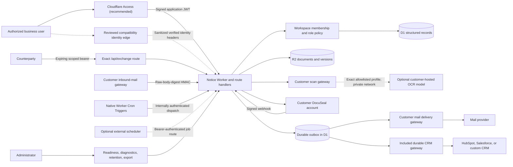

# Architecture

## System shape

Notice is a React/vinext application packaged as a Cloudflare Worker. A production deployment selects one workspace. All persisted records and object keys are still workspace-scoped so authorization is enforced at the storage boundary rather than inferred from the UI.



The adoption boundary has three parts. The repository owns the reusable application behavior inside the Worker and the D1/R2 data model. An implementation partner repeatedly provisions and verifies each deployment, connects the supplied provider boundaries, and configures customer-approved governed templates, workflows, intake forms, playbooks, groups, and direct/group lane authorities. The customer supplies the real identity/authority matrix, paper, policy, accounts, credentials, data/records decisions, and go-live approval that source code cannot safely invent.

## Request and identity boundary

`app/layout.tsx` and protected APIs resolve a permission context from:

1. either a cryptographically verified Cloudflare Access application JWT (recommended) or the subject, email, and encoded display name from an explicitly selected compatibility-header edge;
2. the configured production workspace;
3. an active user record;
4. an active workspace membership; and
5. the role-to-permission matrix in `app/lib/authorization.ts`.

Production is the default mode. It requires a 3–63 character workspace identifier made of lowercase letters, digits, or hyphens and starting alphanumeric, an organization-approved display name, a canonical public origin, and one explicit authentication mode. `cloudflare-access` requires the exact Access team origin and application audience and requires `NOTICE_TRUST_IDENTITY_HEADERS=false`; Notice verifies signature, issuer, audience, time, token type, subject, and email itself. The `trusted-headers` compatibility mode instead requires `NOTICE_TRUST_IDENTITY_HEADERS=true`, asserting that the deployer has blocked direct origin access and that the edge strips caller-supplied identity headers before injecting verified values.

Bootstrap has two valid production states. During controlled onboarding it is enabled with at least two distinct verified administrator emails. After durable administrators and recovery are proven, it is disabled and the bootstrap email list is empty. A disabled bootstrap is the required steady state, not a configuration error.

Bootstrap administrator emails may create the initial workspace, user, and administrator membership. Other users are invited by email. Their first request carrying a matching verified edge email binds the pending record to its provider subject; an already-bound identity is not rebound.

Evaluation behavior is available only through explicit `NOTICE_APP_MODE=evaluation`. It uses a synthetic identity and may merge seed data into the UI. Production never falls back to that identity or those records.

### Roles

| Role | Intended authority |
| --- | --- |
| `admin` | All permissions, including workspace access and integration administration |
| `legal` | Agreement, approval, obligation, language, document, audit, and notification work; no workspace or integration administration |
| `approver` | Read agreement/document/audit context, claim an eligible unassigned request regardless of its lane label, and decide approvals assigned to that user |
| `requester` | Read/create agreements, upload documents, request approvals, and read related workflow data |
| `viewer` | Read-only agreement, approval, obligation, language, document, and audit access |

Every route declares a required permission. Operations with finer rules—such as an approver deciding only their assigned request—perform additional checks after authorization.

These five lowercase roles are generic workspace identity roles. They are a different namespace from approval lane labels such as `Legal`, `Finance`, or customer-defined lanes, even though the approval-request column is named `role`. Claim and decision operations additionally evaluate `approval_lane_authorities`: one active record can authorize a direct user or an active workspace group in one exact currency, optionally only up to a minor-unit ceiling. The same predicate is repeated at commit time. A lane with no authority record at all retains a narrow compatibility default—`admin`/`legal` for `Legal`, `admin`/`approver` for `Finance`, and `admin` for any other lane. Creating or revoking the first record for a lane disables that fallback, so an unmatched user fails closed. Customer policy still decides which records should exist; a broad technical role is not itself delegated business authority.

## Application and route layers

| Path | Responsibility |
| --- | --- |
| `app/page.tsx` | Product views, workflow interaction, explicit loading/error state, and evaluation-only seed behavior |
| `app/layout.tsx` | Page-level access gate and sign-in redirect |
| `app/lib/auth.ts` | Cloudflare Access JWT or compatibility-header identity resolution, user/member bootstrap, and binding |
| `app/lib/authorization.ts` | Pure roles, permissions, tenant helpers, and server audit attribution |
| `app/lib/approval-policy.ts` | Server-enforced repository approval lanes and exact-basis aggregate evaluation |
| `app/lib/approval-authority.ts` | Direct/group lane authority with exact currency and optional minor-unit ceiling plus the bounded legacy fallback |
| `app/lib/agreement-basis.ts` | Stable hash of material agreement fields and the immutable working-document identity |
| `app/lib/money.ts` | Canonical currency-code handling, zero/two/three-decimal minor units, and display formatting; no FX conversion |
| `app/lib/governed-template-runtime.ts` | Exact published-template rendering and variable/content digest verification |
| `app/lib/workflow-policy.ts` | Published approval-workflow parsing, deterministic condition evaluation, and agreement snapshot digest |
| `app/lib/enterprise-domain.ts` | Canonical enterprise JSON/digests, dedupe keys, and shared domain errors |
| `app/lib/repository-intelligence.ts` | Bounded playbook, fragment, citation, proposal, ingestion, and repository-search contracts |
| `app/lib/work-item-pagination.ts` | Tenant/query-bound live-queue cursors with a page-one insertion fence for approvals, signatures, obligations, schedules, and events |
| `app/lib/portfolio-report.ts` | Bounded portfolio filters and per-currency aggregate validation |
| `app/lib/api.ts` | Shared API authorization, origin guard, per-subject rate decision, and safe error handling |
| `app/lib/validation.ts` | Bounded Zod request schemas and JSON limits |
| `app/lib/persistence.ts` | Agreement lookup, event append, metadata snapshots, and outbox enqueue |
| `app/lib/audit-chain.ts` | Canonical event serialization, hashing, and gap-checked verification |
| `app/lib/document-security.ts` | File inspection, hashing, scan-gateway client, and HMAC primitives |
| `app/lib/docuseal.ts` | Submission/reconciliation API, webhook HMAC verification, and constrained artifact download |
| `app/lib/integration-status.ts` | Redacted provider configuration status |
| `app/lib/integration-runtime.ts` | Harmless live provider diagnostics |
| `app/lib/delivery.ts` | Canonical HMAC-signed outbox delivery |
| `app/lib/records-governance.ts` | Retention normalization, legal-hold/purge rules, and object-key ownership checks |
| `db/schema.ts` | Drizzle D1 schema and indexes |
| `db/ensure.ts` | Local evidence/evaluation bootstrap plus shared schema-policy entry point; ordinary production remains read-only |
| `drizzle/` | Reviewed generated migration history |
| `wrangler.jsonc` | Customer-independent Worker profile and logical `DB`/`DOCUMENTS` bindings |

API details and permissions are in [API](./API.md).

## Storage model

### Identity and tenancy

- `workspaces` — configured workspace identity and status.
- `users` — verified provider subject, normalized email, display name, status, and last-seen time.
- `workspace_memberships` — workspace/user role and status, with a composite identity.
- `workspace_groups` and `workspace_group_members` — manually managed group identity and membership, with external-provider identifiers reserved for reviewed synchronization but no bundled SCIM client.

### Agreement domain

- `agreements` — lifecycle, commercial metadata, canonical minor-unit value/currency, stable owner/entity/counterparty/template/workflow references, exact workflow-policy digest and evaluated lane snapshot, status, version, server attribution, retention, legal hold, and soft deletion.
- `legal_entities` and `counterparties` — workspace-scoped reference records with lifecycle, jurisdiction/registration metadata, and deterministic counterparty dedupe.
- `agreement_parties` and `agreement_relationships` — typed party roles and directional agreement links with tenant, target, distinct-record, uniqueness, and per-role primary integrity.
- `custom_field_definitions` and `custom_field_values` — typed workspace definitions and JSON values bound to an active agreement, counterparty, or legal entity.
- `saved_views` — owner-scoped, optionally shared, bounded filter/sort JSON for supported resources.
- `governed_templates` and `governed_template_versions` — parent lifecycle plus immutable published/retired self-contained bodies, variable schema, reserved-empty language-block ID field, and content digest. Nonempty language-block composition fails closed until immutable block content/version snapshots and deterministic composition exist.
- `workflow_definitions` — immutable published/retired approval-lane policies with deterministic conditions and a definition digest.
- `intake_forms` and `intake_submissions` — published structured form versions, exact template-version/workflow pins, answer lifecycle, and conversion linkage.
- `clause_playbooks` and `clause_playbook_versions` — scoped playbook lifecycle and immutable published rules/digest.
- `agreement_versions` — checksum-bearing snapshots of agreement metadata versions.
- `agreement_document_versions` — immutable R2-backed text/Markdown working versions with hashes and authorship.
- `documents` — uploaded/signed artifact metadata, tenant R2 reference, hash, scan state, retention, and legal hold.
- `negotiation_rounds` — one active round per agreement, immutable baseline/outbound lineage, generated reply alias, hashed portal token, expiry, and resolution evidence.
- `negotiation_submissions` — one immutable record per returned attachment or no-attachment message, including source, sender/authentication evidence, scan/review state, and decision provenance.
- `document_comparisons` — exact text-hash provenance and human decision/resulting-version lineage; never an automated legal verdict.
- `language_blocks` — approved language and version.
- `approval_requests` — requester and optional assigned approver, immutable paper/material-basis binding, decision evidence, server attribution, and version.
- `obligation_schedules` — immutable anchored recurrence rule, mutable owner/status/materialization cursor, time zone, reminder policy, attribution, and optimistic version.
- `obligations` — materialized occurrence identity, snapshotted rule terms, assigned owner, reminder cursor, completion attribution, and optimistic version.
- `obligation_evidence` — one immutable native or legacy completion-evidence record per occurrence, including SHA-256 for native evidence.
- `obligation_creation_receipts` — tenant/user/key-scoped request digest and committed record identifiers for retry-safe schedule creation; no response snapshot or exported key material.
- `repository_fragments` — immutable caller-supplied content/offset/source-digest records pinned to one existing agreement working-document ID, version, and SHA-256; the server does not derive the text from canonical bytes.
- `extraction_proposals` and `extraction_proposal_citations` — proposed agreement/custom-field values with extractor identity, confidence, registered fragment citations pinned to an immutable document version/hash, attributable review, and a durable blocker that records no application mutation.
- `ingestion_batches` and `ingestion_items` — at-most-50-item idempotent inventory, source hashes/deduplication, link/review state, and explicit extraction/provider blockers.

### Evidence and asynchronous work

- `agreement_events` — server-authored sequence, previous hash, event hash, verified actor, and activity detail.
- `signature_packets` — DocuSeal submission state, sanitized signer evidence, immutable paper/material-basis binding, active-packet uniqueness, and evidence-document link.
- `webhook_receipts` — provider event/digest uniqueness and processing state for replay handling.
- `outbox_events` — canonical event payload, lock, attempts, retry time, processed/dead state, and diagnostic summary.
- `purge_jobs` — workspace-scoped post-D1 object-cleanup manifest, validated object-key set, retry state, and completion evidence.
- `mutation_guards` — transient CHECK-constrained rows that make a zero-row guarded mutation abort its D1 batch; successful operations delete their guard row in the same batch.

Document bytes never live in D1. R2 keys begin with `workspaces/<workspace-id>/` and separate normal documents, quarantine, signed artifacts, and agreement versions.

## Authoritative mutation flow

For a typical business mutation:

1. The route applies exact-origin protection for browser mutations.
2. Verified identity, membership, and permission are resolved.
3. A bounded schema strips unknown fields and rejects invalid content.
4. The route queries only the verified workspace.
5. The server owns identifiers, workspace ID, actor, timestamps, and permitted lifecycle state.
6. The write includes an expected version where concurrent change matters.
7. The route appends a hash-linked event and metadata snapshot when required.
8. An outbox event is created for downstream work.
9. The authoritative saved record is returned; failures use a non-disclosing error envelope and request ID.

D1 does not make R2 or provider calls part of the same transaction. Routes perform compensating cleanup where practical, but operations must monitor for orphans, failed webhook reconciliation, dead outbox records, and partial retention work.

Submitted-intake conversion is a D1-only guarded exception: after rechecking the immutable submitted answers and exact published form/template/workflow pins, one batch creates the agreement, initial metadata snapshot, audit event, optional CRM outbox projection, and marks the submission converted. The submission status/version predicate and mutation guard make a concurrent loser fail; an exact later call returns the one committed agreement as an idempotent replay.

For approval claim, the guarded update is followed in the same D1 batch by a `mutation_guards` insert whose `guard_changes` value comes from SQLite `changes()`. Its CHECK requires exactly one affected row, so a concurrent or stale zero-row claim aborts the event/outbox/assignment batch rather than recording a claim that did not happen.

## Document ingestion and versioning

Production upload flow:

1. limit the request, ignore caller MIME as authority, and inspect the complete bounded bytes for the supported structure: well-formed/control-bounded UTF-8, balanced bounded RTF without binary/object payloads, PDF header/trailer/xref and referenced-object structure, or a canonical DOCX/OOXML ZIP with required safe and consistent central/local entries, bounded required-part XML structure, and count/size/ratio/overlap bounds;
2. normalize the displayed name and compute SHA-256;
3. send the bytes and metadata to the customer scanning gateway using HMAC authentication;
4. reject malicious content, or store unavailable scans under a tenant quarantine prefix;
5. after a clean result, extract bounded plain text/RTF in production; for PDF/DOCX, either record the explicit human-reviewed-text path or, during link, request the one deployment-selected customer-hosted OCR model/profile through the same signed scanner gateway;
6. store metadata and scan evidence in D1; and
7. allow linking/download only for an accepted scan state.

Quarantined objects can be rescanned. Before scanner I/O, the route atomically claims the exact D1 document/version/object/hash state under a five-minute lease; a second live call is blocked and only an expired claim can be recovered. Because R2 is private and every read is gated by the D1 scan status, a clean rescan promotes the exact object in place and applies the same format-specific extraction boundary; it does not create a superseded quarantine object that could be stranded after an ambiguous D1 result. A fresh exact-correlated malicious verdict is reconciled even if another worker already committed clean, so it dominates that race and preserves the current cleanup, legal-hold, and negotiation lineage. A malicious result atomically marks the record rejected and, unless the document or parent agreement is held, queues the exact key in the durable cleanup ledger. The retention worker rechecks both holds immediately before deletion and claims the cleanup in D1; legal-hold activation is transactionally fenced until that claim records either successful deletion or an explicit failure. Claims never expire into a second deletion attempt, so an interrupted claim fails closed for operator reconciliation. Draft content versions are stored under immutable version-numbered R2 keys and guarded by the agreement version.

Production deliberately limits in-Worker PDF/DOCX parsing to the bounded structural admission checks above; it does not render either format, extract its document text, or interpret its content or tracked changes there. With OCR disabled, it stores the clean scanned source and waits for authorized reviewed text. With OCR enabled, linking sends the exact immutable bytes only to the existing scanner gateway under a signed versioned operation; the gateway must freshly scan, privately resolve the exact deployment-selected model/profile, and return nonblank bounded text with matching source hash/model/profile. Notice accepts at most 400,000 characters and 2,000,000 UTF-8 bytes and claims the source as unreadable before inference. Unavailable calls restore its prior clean state; uncorrelated or malformed clean responses retain quarantine. Known clean-result persistence failures remove uncommitted staging and release for retry, while ambiguous final D1 outcomes are resolved by exact source/version readback. An exact-correlated malicious verdict dominates malformed ancillary fields and creates a rejected policy-only target association whose later legal holds fence cleanup. A successful result writes immutable working version 1 plus R2/audit provenance. There is no fallback. The model/runtime, parser sandbox, weights, capacity, egress, region, patching, and licensing remain customer infrastructure described in [Customer-hosted OCR](./CUSTOMER_HOSTED_OCR.md). Production supports bounded in-process RTF and plain-text extraction. Explicit local evaluation may heuristically parse PDF/DOCX files up to 5 MiB; that is not production evidence. Neither OCR path makes a legal interpretation.

### Repository intelligence boundary

Repository intelligence starts only after an immutable agreement working-document version exists. An authorized extractor may register up to 50 non-overlapping fragments per request and append disjoint ordinals/ranges up to 500 total for one caller-supplied source-text digest. Notice verifies that the referenced document-version ID, version number, and document SHA-256 exist, then stores the caller-supplied complete-source-text SHA-256, ordinal, code-point offsets, fragment content/hash, extractor, and extractor version. It does **not** read the canonical working bytes to derive or compare the registered text, source digest, or offsets. Exact batch retries are idempotent; an ordinal conflict, overlap, extractor-version change, or total-limit breach fails closed, including under concurrent registration.

Search is provider-neutral literal term matching over those registered fragments. It is workspace-scoped, snapshot/cursor-paged, and returns the agreement/document version pin plus the registered offsets, fragment text, document hash, source-text digest, and fragment digest. These values prove internal record consistency, not that the caller's text corresponds to canonical working-paper bytes. Search does not perform OCR, extraction, embeddings, semantic inference, or a legal conclusion; a reviewer must open the protected working paper and verify every returned passage.

An extractor may create a confidence-bearing proposal for a bounded core agreement field or an active typed custom field only when one to twenty citations reproduce substrings inside registered fragments carrying the same document-version/hash pin and caller-supplied source-text digest. Creation requires a UUID idempotency key: the exact same creator/material replays the committed proposal and citations, while different material under that key fails with a conflict. Citation validation does not prove correspondence to canonical paper. A human with document-management authority must compare the citations with the protected working paper before accepting or rejecting the proposal with a reason. Either decision appends review evidence; even an accepted proposal remains `applicationStatus=blocked` with `governed_executor_required`, so agreement and custom-field values do not change. The bounded ingestion API inventories up to 50 source objects per idempotent batch, detects exact SHA-256 duplicates, can link only a matching live document, and reports when an extraction provider is not configured. It is not a bulk uploader, OCR engine, or automatic repository migration.

## Counterparty negotiation lifecycle

Preparing a round pins the latest immutable working version, or an eligible clean `initial_source` when no working version exists, and creates an exact outbound copy with its full SHA-256. A workspace/active-key uniqueness constraint permits only one active round per agreement, and signature creation, new working-version writes, document relinking, and agreement deletion are fenced while it remains unresolved.

When enabled, the counterparty portal uses a random 32-byte bearer whose SHA-256—not plaintext—is stored on the round. The plaintext is shown only when issued. It remains usable until expiry, rotation, round close, or promotion; an upload does not consume it. Durable counters belong to the round rather than the token, so rotation never restores transfer capacity. Before body read or scanner work, D1 atomically admits one upload attempt, reserves the 21 MiB request ceiling, and holds the sole five-minute work lease. A round permits at most 10 admitted uploads, independently capped at 4 accepted and 6 rejected/failed attempts and 96 MiB of cumulative multipart bytes. The completed read reconciles the reservation to actual bytes; aborted/oversized reads retain the full reservation, stale leases are charged rejected before recovery, and stale owners cannot commit. Downloads are atomically charged before R2 and capped at 20 attempts/256 MiB; failed reads remain charged. A live competing upload receives `429` plus `Retry-After: 5`, while exhaustion requires a new round. Public responses are no-store, no-referrer, frame-denied, route-scoped, expose static budget policy but no counters/reservation identifiers, and return only exchange metadata or opaque receipt IDs. Automated mail remains disabled until the general gateway is configured and the separate `NOTICE_NEGOTIATION_MAIL_ACCEPTED` attestation records a successful rendered-link/recipient/reply acceptance. It then temporarily places the current portal URL in the protected `negotiation.round_requested` outbox payload, validates the active round/token/origin/outbound hash again immediately before delivery, and replaces the URL with a redaction marker plus SHA-256 at accepted or terminal-dead state. Rotation, close, and promotion have both preflight and commit-time fences against a pending or processing delivery.

The authenticated round projection derives `not_queued`, `queued`, `processing`, `accepted`, `dead`, or `manual_recorded` from the delivery method and durable parent-outbox state. Terminal outbox finalization reconciles the active round and agreement queue under compare-and-swap guards. Current-round submission priorities—ready, sender review, quarantine, rejection, then no attachment—override transport state so a later low-priority message or delivery result cannot hide an existing human-review task. Gateway acceptance means durable gateway responsibility, never counterparty receipt.

The optional inbound-mail boundary uses a dedicated generated alias and HMAC over the timestamp plus SHA-256 of the exact raw multipart body. The signed manifest binds event ID, provider message ID, recipient alias, sender/alignment evidence, attachment metadata, and attachment hashes. Aggregate-bound receipts make exact retries idempotent and reject changed event/body/message identities. Portal and signed-mail returns to an inactive round fail closed; an authenticated staff upload can deliberately retain a late file as non-promotable evidence.

Every returned attachment is content-inspected, SHA-256-bound, scanned, and stored separately. Unavailable scans remain quarantined, malicious/invalid files are rejected, and email sender/alignment mismatch requires explicit staff verification. Only a clean, ready submission from the latest active round can be promoted. Promotion takes complete human-reviewed plain text or Markdown, binds it to the immutable returned source, creates a new working version, resolves and revokes the round, supersedes prior approval authority, and requires approval again. Notice does not parse Word tracked changes or decide whether any term is acceptable.

## Governed agent boundary

The bounded `/api/v1` surface separates signed workload identity, one exact active grant, its current human sponsor, a canonical plan, human decision, and service-principal execution. The grant sponsor cannot approve or reject that plan. The decision transaction repeats that separation and requires the deciding user and workspace membership to remain active with the Admin role at commit, so a concurrent demotion or disablement stops the write. For `agreement.read`, both the execution claim and the result commit independently repeat the exact principal/version, grant/action/resource/policy/time window, active sponsor authority, agreement version, and latest working-document ID/version/hash predicates. Revocation or paper drift therefore cannot authorize one stale protected read between the route's preflight and its durable receipt.

## Approval lifecycle

All new, imported, generated, converted, and materially changed work starts `Unassessed` with approval `Required`. Legal/Admin records an attributable risk decision against the exact latest working-version number, SHA-256, and computed risk basis. A new paper or material edit clears the risk evidence and supersedes stale approvals. `Required` means policy calls for routing but no current request has been created, while creating a request moves the aggregate to `Pending`.

When an agreement selects a published workflow definition, Notice parses the narrow schema-version `1.0` approval contract and snapshots both its SHA-256 and the lanes produced for the exact side, agreement type, department, risk/disposition, currency, and minor-unit value. Conditions inside a lane are ANDed and values inside one condition are ORed; at least one unconditional lane guarantees a fail-closed review path. Material metadata or risk changes re-evaluate the exact definition and update the snapshot. Approval and agent-plan bases bind the workflow definition, policy digest, and evaluated lanes, so retirement can preserve an existing exact snapshot without allowing a silent policy substitution.

Agreements with no governed workflow use the compatibility starter policy: every routed agreement requires `Legal`; High risk, a risk waiver, or USD value above 100,000 requires `Finance`; any material non-USD value also requires `Finance` because Notice has no FX source. Monetary values are stored as non-negative minor units plus a three-letter uppercase currency code, using the supported zero/two/three-decimal mapping. Notice never converts or totals currencies together.

All non-superseded current requests must be approved by an attributable decider different from the requester, and each required lane must have a distinct decider. Requests bind to the exact latest working-document version/hash and a stable hash of the material agreement, risk, workflow, and money fields; the decider submits that evidence and confirms review. An eligible user can atomically claim an unassigned request only when direct/group/legacy authority covers the lane, exact currency, and amount. The same authority predicate runs again in the committing batch; assigned users cannot decide another member's work.

## Signature lifecycle

The server creates DocuSeal submissions only for agreements in `Signature` with approvals complete or not required. For approved work, every live request must cover the exact latest immutable document version/hash and material agreement basis. Before a new production packet is shown, Notice validates the pinned DocuSeal 3.2.1 deployment/API-contract/entitlement profile and reads the configured template's one-to-ten ordered unique roles. The template must be non-archived, non-public, and give every role a required signature or initials field. Creation requires one unique email per role and an exact role/order match. Notice SHA-256-verifies the immutable text/Markdown bytes, decodes and escapes the working text into DocuSeal's one-off HTML document, attaches the configured customer signature-page/template, preserves order, requests merged evidence, applies the bounded expiration and configured email 2FA, and asks DocuSeal to deliver every invitation by email. Production returns `embedSrc: null` and never exposes, stores, audits, or exports signer bearer URLs; explicitly labeled local evaluation uses an entirely local signing simulation and neither embeds nor contacts a provider. Optional self-hosted MCP is diagnostic-only: the handshake requires HTTP 202 for `notifications/initialized`, validates the pinned tool inventory/annotations, then invokes only read-only `load_template` and requires the result to match the REST-selected template and ordered roles. Mutation/open-world tools remain unreachable.

A workspace/agreement active-key uniqueness constraint prevents concurrent in-progress submissions. Before the provider call, Notice stores a `creating` packet and stable signer recovery keys. Every create non-success, malformed response, or transport failure retains `creating`; a retry reconciles the same provider submission rather than issuing another. An unmapped reservation is released only when a workspace administrator invokes `abandon_unmapped` after one hour and a fresh provider lookup returns exactly empty. Mapped `pending`, `partially_signed`, `reconciling`, and `archived` packets can be refreshed. A request that encounters an already-held fresh reconciliation lock returns `202`; stale locks are restored after 15 minutes. Provider `archived_at` is reversible and therefore retains the active key. An administrator may explicitly `supersede_archived` only after a fresh provider read confirms archived/pending; stale-basis recovery becomes `superseded`, and any later completed paper becomes nonactivating `completed_superseded` evidence.

DocuSeal callbacks are verified against the raw body using a timestamped HMAC with a five-minute tolerance. The body digest and provider event identifier support durable replay handling, including stale-lease recovery, and matched callbacks are aggregate-bound to the signature packet so retention can remove their provider identifiers with the agreement. Completion is never accepted from the browser: Notice re-reads provider state and requires the exact expected signer count, one-to-one provider identity/email matches, and `completed` status for every signer before it retrieves exactly one final artifact. It downloads only from the configured/official HTTPS boundary, scans that artifact, stores signed evidence in R2/D1 under the parent retention/hold policy, and recomputes the latest basis. Existing evidence is reused only for the exact packet lineage after the retained R2 bytes—not only metadata—pass a fresh SHA-256 check. A current completion becomes `completed_review_required`; Legal/Admin must then confirm the exact agreement version, approved basis, working-paper hash, retained evidence ID, and final artifact SHA-256 before a guarded transaction activates the agreement. A stale completion becomes retained `completed_superseded` evidence and cannot activate.

## Delivery and CRM boundary

Business changes and reminders enter `outbox_events`. The authenticated job route claims up to 25 records, recovers locks older than ten minutes, and delivers a canonical envelope:

```json
{
  "schemaVersion": "1.0",
  "event": {
    "id": "uuid",
    "workspaceId": "customer-workspace",
    "topic": "agreement.stage_changed",
    "aggregateType": "agreement",
    "aggregateId": "123",
    "payload": {},
    "createdAt": "ISO-8601"
  }
}
```

Headers carry event ID, Unix timestamp, and `sha256=<HMAC-SHA256(...)>`. Each gateway must reject stale/invalid/replayed requests and return 2xx only after durable acceptance. The outbox persists an immutable per-event sink set, retains accepted destinations, retries only transient failures for the failed sink, and finalizes the parent only after every sink accepts. Permanent redirects/other 4xx responses dead-letter immediately; transient failures dead-letter after eight attempts.

Mail and CRM are independent durable sinks. The customer mail gateway remains the mail-provider boundary. The repository's separately deployed CRM gateway verifies the CRM-specific signature/profile, persists D1 receipts before acceptance, fences aggregate versions, and includes HubSpot private-app, Salesforce client-credentials/external-ID, and signed custom-webhook adapters. Customer secrets and approved field mappings stay in the gateway deployment; the main outbox never receives provider credentials.

The frequent main Cron first attempts the obligation job and then the outbox job, collecting both outcomes so one failure cannot starve the other. Obligation materialization reads only active schedules under non-deleted executed agreements with active eligible owners, computes the next calendar occurrence from the original anchor, and atomically compare-and-swaps the schedule cursor before inserting a uniquely numbered occurrence, audit event, and outbox event. Reminder processing uses each occurrence's time zone, collapses missed windows into one catch-up, advances the cursor without changing the occurrence's business version, and revalidates parent/owner/recipient eligibility again at delivery.

## Audit, retention, and export

Agreement events hash canonical stored fields—including structured source agent-plan attribution when present—and the previous event hash. Verification rejects altered fields, broken links, duplicates, and sequence gaps while retaining bounded compatibility for pre-fix v16 attributed events. Agreement and workspace export routes submit all contributing D1 reads in one transactional batch snapshot before validation or signing, so concurrent domain/provider/job writes cannot create a mixed-version signed view. Agreement audit export includes versions, decisions, documents, signatures, obligation schedules/occurrences/evidence, and the exact source-attributed agent plans plus their decisions/executions. A dangling, cross-agreement, authority-mismatched, or digest-mismatched agent-evidence edge stops export. The envelope carries chain and referential-closure verification under SHA-256; production also requires an HMAC key. R2 bytes remain separate retrievals whose size and digest must be checked against the signed snapshot.

Workspace export includes structured records—including soft-deleted rows and obligation schedules/occurrences/evidence—plus a count of obligation creation receipts, sanitized purge-job/integration-diagnostic ledgers, and the complete tenant-local service-principal -> grant -> run -> plan -> decision/execution evidence graph. It verifies that graph and source-agent-plan attribution before signing. Purge object keys/errors, secret-backed diagnostic fingerprints/detail, idempotency-key material, receipt keys, and receipt request digests are not exported. The artifact manifest retains sizes, hashes, scan/retention state, application download paths where available, and tenant-scoped storage references; binary bytes must be retrieved separately and verified against it.

Retention policy may be set on an agreement or document. Agreement legal hold takes precedence for linked documents. The scheduled job:

- soft-deletes expired, unheld Active agreements and eligible documents;
- waits the configured 7–365 day purge grace;
- refuses agreement purge while any linked document remains held or ineligible;
- validates every R2 key belongs to the workspace before deletion;
- commits the guarded D1 deletion, durable `purge_jobs` storage manifest, dependent-row cleanup—including obligation receipts, evidence, occurrences, and schedules—and `retention.d1_purged` audit/outbox evidence atomically before touching R2;
- retries existing `storage_pending` manifests before evaluating new candidates; and
- deletes validated R2 objects only after the D1 commit, marking the manifest completed or retaining a safe retry error without attempting to recreate purged D1 state.

`retention.d1_purged` means only that D1 deletion committed and its payload deliberately reports `storageStatus=storage_pending` plus a `purgeJobId`. The matching `purge_jobs` row and retention-job result are authoritative for eventual R2 completion; there is no separate final-storage outbox topic. External backups, logs, exports, indexes, and providers are not automatically changed by this job.

## Schema lifecycle

`db/ensure.ts` has two deliberately separate paths. Local evaluation and the explicit isolated production-evidence harness may create compatible tables and perform additive compatibility work. Ordinary production performs only a read-only lookup of `notice_schema_state`, currently requires exact marker version **21**, caches a successful check per Worker isolate, and fails with a safe 503 response when migrations are missing, older, or newer. Production request handling never runs `CREATE`, `ALTER`, marker writes, or optimization pragmas.

Current hardening migrations through `0017` provide immutable approval/signature basis, provider and negotiation evidence, agent governance, and recurring obligations. Migration `0018` adds legal entities, counterparties, workspace groups, typed custom fields/values, saved views, governed template versions, governed workflow definitions, intake forms/submissions, direct/group lane authorities, structured agreement parties/relationships, stable owner/reference fields, and canonical minor-unit currency values. Migration `0019` adds exact workflow snapshots and intake-template-version pins, immutable clause-playbook versions, version/hash-pinned registered repository fragments and cited extraction proposals, bounded idempotent ingestion batches/items, and stronger tenant/referential/primary-party integrity rules. Migration `0020` adds immutable tenant- and administrator-bound receipts for atomic, retry-safe creation of governed templates and clause playbooks with their first versions. Migration `0021` adds durable per-round portal upload/download budgets and one expiring upload-work reservation. Production must apply all committed migrations before running an application revision that requires marker 21.

For every schema change:

1. edit `db/schema.ts`;
2. increment `NOTICE_SCHEMA_VERSION` in `db/schema-guard.ts`;
3. run `npm run db:generate` and append the matching marker update as the migration's final successful statement;
4. inspect generated SQL and Drizzle metadata;
5. test forward migration against a realistic isolated copy;
6. validate rollback/recovery and application compatibility;
7. apply through the deployment platform in staging; and
8. promote and record the production migration before depending on the new schema.

Never point local tooling at production D1/R2. Never edit or delete a generated migration already applied to an environment.

## Operational boundaries

The repository provides liveness, D1/R2 reachability, readiness policy, provider diagnostics, request IDs, durable job state, and safe errors. It does not provide the customer's observability backend, edge rate limits, paging, backups, restore automation, immutable evidence store, or incident organization. See [Operations](./OPERATIONS.md) and [Production setup](./PRODUCTION_SETUP.md).
