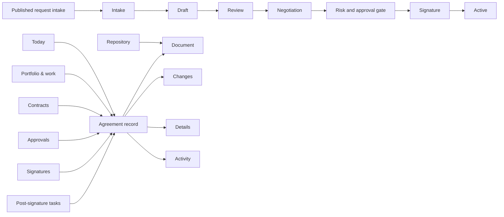

# Notice user guide

Notice gives business, legal, procurement, and operations teams one governed agreement record from intake through drafting, approval, signature, and post-signature obligations. This guide explains what a signed-in user sees and what each action does. Deployment instructions live in [Production setup](./PRODUCTION_SETUP.md).

Prefer a visual, searchable walkthrough? Open the self-contained [HTML how-to guide](./how-to/index.html) after cloning the repository.

## Use this guide

This is the complete GitHub-native operating manual. Use the table of contents to jump directly to the task in front of you:

- [Evaluation and production](#evaluation-and-production-are-deliberately-different), [roles](#your-role-controls-what-you-can-do), and [the operating model](#the-operating-model)
- [Today](#1-start-with-today), [Contracts and saved views](#2-find-and-open-an-agreement), [template creation](#3-start-from-a-template), and [upload/OCR](#4-upload-an-existing-contract)
- [Agreement workspace](#5-work-inside-an-agreement), [approvals](#6-approve-with-context), [signature](#7-track-signature-and-signed-records), and [obligations](#8-operate-post-signature-obligations)
- [Published request intake](#9-complete-governed-request-intake), [Portfolio & work and Repository](#10-use-portfolio--work-and-repository), and [reusable building blocks](#11-govern-reusable-building-blocks)
- [Integrations](#12-understand-the-integration-boundary), [Setup & access](#13-set-up-and-administer-a-workspace), and [keyboard/mobile use](#14-use-notice-with-a-keyboard-or-on-a-small-screen)
- [Safe recovery](#15-recover-safely), [first-contract checklists](#16-first-contract-checklists), [glossary](#17-glossary-and-deeper-documentation), [persistence](#what-is-persisted), and [customer responsibilities](#what-the-adopting-business-still-supplies)

> [!IMPORTANT]
> Evaluation uses synthetic records to demonstrate navigation and workflow. A production workspace shows only its own records and the actions allowed for the signed-in member's role.

> [!CAUTION]
> Use synthetic documents in evaluation mode. A production deployment should admit real data only after identity, storage, providers, policy, diagnostics, and customer acceptance are complete.

## Evaluation and production are deliberately different

| | Evaluation mode | Production mode |
| --- | --- | --- |
| Identity | Explicit local synthetic administrator | Verified trusted-edge identity and an active workspace membership |
| Records | Synthetic examples help demonstrate the lifecycle | Only records loaded from the workspace's D1/R2 resources; there is no synthetic fallback |
| Permissions | The synthetic administrator can exercise the product | The server checks the member's role on every protected action |
| Documents | Synthetic files only; scanning may use the explicit evaluation bypass | Clean uploads proceed; unavailable or inconclusive scans remain quarantined; invalid or malicious content is rejected |
| Counterparty negotiation | Sample comparison cards and synthetic actors | Immutable hash-bound rounds, expiring portal links, optional signed email returns, scanned source files, human-reviewed text, and explicit promotion |
| Governed setup and intake | Labeled examples where supplied | Versioned templates/workflows/intake forms/playbooks, structured enterprise records, and submitted-intake conversion against exact published pins |
| Repository and reporting | Sample context is not customer evidence | Search over extractor-registered fragments pinned to immutable document version/hash, mandatory human citation verification, extraction proposals with mutation blocked, paged work queues, and per-currency portfolio reporting |
| E-signature | Entirely local, clearly labeled simulated completion | Configured DocuSeal packet, verified webhook reconciliation, and scanned signed evidence |
| Notifications and CRM | Safe demonstration states | Durable outbox with independent signed mail and CRM gateways |
| Evidence | Useful for evaluation, not production evidence | Hash-linked audit history and signed exports when the signing key is configured |

Production access fails closed when identity, workspace, or storage is unavailable. A provider-dependent action blocks, quarantines, or remains queued when its provider boundary is unavailable; it never silently switches to example data or simulated evidence.

## Your role controls what you can do

Notice derives the role and permissions from the server session. Actions a member cannot perform are hidden or read-only; changing a request in the browser cannot grant more authority.

| Role | Typical product access |
| --- | --- |
| `requester` | Read agreements, create or import work, request approvals, read approvals, obligations, and approved language, and add activity comments |
| `approver` | Read agreement context, claim an eligible unassigned approval, and decide an approval assigned to them; an approver cannot decide another member's assigned request or their own request |
| `legal` | Create and update agreements, manage document versions, approvals, obligations, approved language, comments, and reminders |
| `viewer` | Read agreements, documents, approvals, obligations, language, activity, and audit evidence |
| `admin` | All product actions plus workspace access, readiness, provider diagnostics, retention/legal holds, and workspace export |

These five lowercase workspace roles provide generic technical access control. They are separate from the capitalized approval lane labels stored on a request, such as `Legal` and `Finance`. A `legal` workspace member is not automatically the named `Legal` lane authority as a matter of customer policy, and `approver` does not mean “Finance approver” or another specific business delegation.

Use individual accounts and least privilege. Keep at least two active administrators for operational resilience even though Notice technically prevents only removal of the final active administrator. An administrator should not use elevated access for routine requester or approval work when a narrower role is sufficient.

Technical permission alone does not authorize an approval. For assignment, claim, and decision, Notice also checks the current lane-authority records: one active record may authorize a direct user or an active workspace group for one exact currency and, optionally, only up to a minor-unit amount ceiling. A lane with no authority record at all uses the narrow compatibility mapping—`admin`/`legal` for `Legal`, `admin`/`approver` for `Finance`, and `admin` for another lane. Creating or revoking any record for that lane turns the fallback off; an unmatched user then fails closed. Notice repeats the authority check when the decision commits and separately enforces requester/decider and required-lane separation. The customer still decides who has business authority to approve terms, sign, place a legal hold, or change policy.

## The operating model

Notice uses the same lifecycle for sell-side, buy-side, and corporate agreements:

The risk and approval gate is not a separate stored lifecycle stage. It rechecks the exact current paper before Notice can enter Signature.

The interface follows four navigation rules:

1. Selecting an agreement name, queue row, approval, signature, or obligation opens that exact agreement.
2. The agreement workspace remembers where you came from. Its back button names that view, such as **Back to Approvals**.
3. The stage rail shows lifecycle status; it is not a shortcut around approval or signature controls. Use the stage-aware primary action.
4. Global search spans the browser-loaded workspace collection and is labeled when that collection is partial. The Contracts page has separate server-backed search and filters across the full saved register.

## 1. Start with Today

1. **Choose the right intake path.** Members with the required permission can complete a published request form, upload an existing contract, create from an exact published governed-template version, or use a clearly marked ungoverned starter.
2. **Move work forward.** Ranked actions open the contract on the relevant tab: the synthetic **Review & redlines** comparison on evaluation records, **Contract details** for metadata and approvals, or **Working draft** for drafting and signature work.
3. **Open the exact record.** Each ranked action opens its source agreement. Dedicated Approvals, Signatures, and Post-signature tasks queues remain available from the main navigation.

Production Today is calculated from the current workspace's records. A new workspace gets a five-step first-use path—submit intake, upload, or choose paper; confirm the draft and details; run a secure counterparty review round and explicitly promote any accepted return; approve the exact resulting saved version; then sign and track follow-up work—not synthetic parties or counts. A wealth-management adopter can use the [starter implementation profile](./WEALTH_MANAGEMENT_PROFILE.md) to assign owners and rehearse that complete path with synthetic vendor paper.

## 2. Find and open an agreement

1. **Search this register.** This field narrows only the current contract register.
2. **Filter and sort.** Combine contract direction, stage, and risk, then sort by update, value, or risk. Reset clears the register query.
3. **Open from anywhere on the row.** The non-checkbox area is one accessible hit target. The checkbox remains reserved for selection.
4. **Page through matching rows when needed.** Contracts search, direction/stage/risk filters, sort, and total-matched count are server-backed across the full saved register; changing a control restarts that exact query from page one. **Load more agreements** displays the remaining matches while preserving its query-bound cursor. Checkbox selection covers only displayed rows. Global quick-search results and workspace metrics that depend on the browser-loaded collection remain explicitly labeled when the broader estate is only partially loaded. **Portfolio & work** uses separate server-side aggregation and never combines currencies.

### Search from anywhere

Select the top search field or press `⌘ K` / `Ctrl K`.

1. **Search globally.** Results can match counterparty, type, owner, department, CRM label, contract direction, stage, and tags.
2. **Jump to a workflow.** Available quick actions open **Start from template**, **Upload a contract**, or approvals. Permission-restricted actions are not offered.
3. **Open the exact result.** Choosing an agreement closes search and opens its record while preserving the originating context.

Press `/` to focus global search and `N` to start from a template when focus is not already in an input, text area, select menu, or editable text region.

### Save and reuse a Contracts view

The Contracts page can save the current bounded register query—search, direction, stage, risk, and sort—as a named view.

1. Set the register controls exactly as you want them, then choose **Save current view**.
2. Give the view a clear name and choose whether it is private or shared with the workspace.
3. Apply a saved view to restore its controls and reload the server-backed register from page one. Loading or applying errors remain visible with **Retry**; the product does not pretend that stale browser rows are the saved result.
4. The owner may remove a private or shared view. An administrator may remove another member's shared view only with the required reason and confirmation. Removing a view never deletes an agreement or changes its metadata.

Saved views are reusable query definitions, not frozen report snapshots. Refresh after agreement mutations, and continue paging when the register says more matches exist.

## 3. Start from a template

### Choose governed paper or an ungoverned starter

1. **Choose the contract direction.** Customer, supplier, and company contracts group the relevant template family. The underlying implementation retains its technical side codes.
2. **Check the governance label.** A **Published governed template** identifies the exact immutable version and digest approved in this workspace. An **Ungoverned starter** is useful scaffolding only and is never automatically the customer's approved legal paper.
3. **Continue.** The wizard carries the direction and template into contract-data entry.

### Bind business data

1. **Select the source.** Manual entry is always available. Salesforce, HubSpot, or custom CRM choices remain unavailable unless the server reports an approved connection.
2. **Add transaction data.** Counterparty and the optional amount/currency populate the draft; Notice stores non-negative minor units plus an uppercase three-letter currency code. Zero-, two-, and three-decimal currencies use their supported minor-unit mapping. Notice performs no FX conversion.
3. **Confirm governance context.** Owner, governing law, optional structured counterparty/legal entity, and a published workflow identify responsibility and the intended approval basis.
4. **Complete required fields.** Counterparty is required; value is optional.

### Review before creating

1. **Check the paper and route.** Confirm whether the choice is an exact published template or an ungoverned starter and whether a published workflow or the compatibility starter policy will apply. Neither label proves a particular person has delegated authority.
2. **Inspect the assembled draft.** Confirm the business data, currency, references, variables, and language before creating a record.
3. **Open the working draft.** Notice creates the durable contract record and immutable first working-document version together, plus the metadata snapshot, audit event, and lifecycle outbox event. The **Working draft** tab reloads that saved version rather than relying on a temporary browser preview. Notice does not create approval requests during intake: review and negotiate the exact saved paper first, then explicitly request the required approval lanes when it is ready for routing.

If the creation response is lost or uncertain, keep the same browser tab and choose **Retry exact intake**. Notice retains the frozen request and its idempotency key for that exact attempt. Do not change the material, open a second wizard, or create another contract to work around an ambiguous response; first let the exact retry read back the one committed record or return a clear failure.

Before production use, the customer must review and publish its governed templates, workflows, intake forms, playbook versions, and delegated-authority records. A published workflow snapshots the exact definition digest and the lanes selected by its bounded conditions. When no governed workflow is selected, the compatibility starter policy requires `Legal` and adds `Finance` for High risk, a recorded waiver, a USD value above 100,000, or any material non-USD amount because there is no FX source. Those are lane labels, not workspace identity roles or proof of an individual's authority. The governed setup screens provide bounded definitions and explicit lifecycle actions, not an automatic legal conclusion or a general no-code policy engine.

## 4. Upload an existing contract

Choose **Upload a contract** from Today or Contracts, or use the global quick action. Notice accepts PDF, DOCX, RTF, and text files up to 20 MiB. It inspects the complete bounded bytes instead of trusting the filename or MIME label: text must satisfy UTF-8/control rules, RTF must be balanced and free of binary/object payloads, PDF must have bounded header/trailer/xref and referenced-object structure, and DOCX must be a canonical bounded ZIP with safe consistent entries, verified expansion/checksums, and required-OOXML-part structure. These structural checks do not prove the document semantically valid or malware-free; scanning and human review still apply.

1. **Review suggestions.** File type, deterministic metadata suggestions, review flags, extraction method, and tags are visible before record creation. They are not confidence scores, policy verdicts, or legal-quality measures.
2. **Confirm editable fields.** Correct extracted parties, dates, commercial terms, and governing law. The current import analyzer has no extracted currency field, so an imported monetary suggestion is created as USD by default; correct its currency and amount in **Contract details** before risk review or approval routing.
3. **Review recorded flags.** Flags provide review context; the heuristic extractor does not make legal conclusions.
4. **Create or link the record.** A clean source is stored in R2 with hash, scan state, and metadata in D1, then linked to the agreement. When readable text exists, Notice also creates the first immutable working version with lineage back to that source. For PDF/DOCX, linking either runs the deployment-selected customer-hosted OCR profile through the signed scanner gateway or follows the explicitly disabled human-reviewed-text path.

You can close the import after upload and resume its field review later in the same signed-in workspace/browser tab. Notice recovers a committed upload after a timeout or reload and keeps the exact agreement intake frozen once creation has been attempted. Choose **Discard staged upload** before creation if you selected the wrong file; this starts a fresh intake, while the abandoned private source becomes eligible for guarded cleanup after seven days. Do not clear browser session data while relying on this convenience recovery. If exact-intake browser recovery is unavailable, stop and use the customer's controlled operator or support reconciliation procedure; there is no general administrator recovery action in the product UI.

In production, a clean scanner result enables storage and linking. Bounded plain text/RTF can be extracted in the Worker. PDF and DOCX first receive bounded in-Worker structural parsing—PDF header/trailer/xref and referenced-object checks, and DOCX ZIP/container plus required-OOXML-part checks—but are not rendered, text-extracted, or interpreted there. When deployment administrators enabled one customer-hosted OCR model/profile, linking uses the same HMAC scanner gateway, accepts only exact profile/hash bounded text, and creates an attributable immutable working version. Gateway unavailability restores the prior clean state for retry; a wrong/unknown response ID or malformed clean result stays quarantined and unreadable. Known uncommitted clean-result failures remove staging and can be retried, while ambiguous final commits are read back before Notice releases anything. A correlated malicious verdict rejects the source under the target agreement's hold policy even when ancillary response fields are malformed. There is no fallback. When OCR is disabled, an authorized human creates reviewed text. If the scanner is unavailable during initial upload, the file remains quarantined. An authorized operational or protected-API rescan first claims that exact source under a five-minute lease, so two live rescans cannot both proceed. A correlated malicious result remains authoritative even if a concurrent clean result committed first. The ordinary import dialog does not expose a rescan action. Evaluation's explicit scan bypass and heuristic PDF/DOCX parsing (limited to 5 MiB) are not proof that a file is safe or production-ready.

OCR is an environment-level deployment choice, not an uploader preference. Individual users do not receive a model picker, endpoint field, or provider credential screen. Notice neither hosts nor bundles an OCR engine, model image, or weights; the customer operates the selected model/profile behind its signed scanner gateway. Administrators can verify the non-secret selected model/profile and diagnostic state in **Setup & access**. See [Customer-hosted OCR and bring-your-own model](./CUSTOMER_HOSTED_OCR.md) for hosting, protocol, failure, and acceptance instructions.

## 5. Work inside an agreement

Every contract has four tabs. Use Left/Right Arrow, Home, and End while a tab is focused:

- **Working draft** — current working paper, durable versions, approved-language insertion, and key health signals.
- **Review & redlines** — synthetic clause cards in evaluation; in production, secure counterparty rounds, returned-file security state, human-review provenance, and explicit working-version promotion.
- **Contract details** — authoritative business/legal metadata, approvals, obligations, and administrator records controls.
- **History & comments** — server-attributed comments and workflow evidence.

### Working draft: edit and save a durable version

When a contract opens, Notice checks durable storage and loads the latest saved content version before enabling another edit or export. Linked uploaded sources appear in the right rail and download only through the protected document route. Choose **Edit working draft**, make the change, then choose **Save version**. Notice stores immutable content bytes in R2, stores the version number and SHA-256 hash in D1, advances the contract version, and appends an audit event. The toolbar identifies the exact saved version and full SHA-256 digest. A conflict asks the user to reload instead of silently replacing a newer save; a load failure blocks editing/export rather than showing starter text as if it were authoritative.

**Download saved draft (.txt)** is disabled while an unsaved edit is open and exports only the exact durable version named in the toolbar; its filename includes the saved version number. Save or discard the edit first. This text file is not the formal audit-evidence package described under **History & comments**.

Leaving the contract, switching to another contract, or cancelling with changed text opens a **Save / Discard / Stay** decision. Closing or refreshing the browser also triggers the browser's unsaved-changes warning. Adding an approved clause always appends to the current browser editor buffer, so existing unsaved edits are retained; save a version to make all of those changes durable.

In **Review & redlines**, reviewer-entered text and the decision note are also browser-only until the corresponding review action completes. Do not navigate away or close the tab while relying on unsaved review material.

### Review & redlines: explore the evaluation comparison

1. **Return with context.** The back control names the originating surface.
2. **Move between record views.** Counts indicate unresolved changes and recorded activity.
3. **Explore the sample decision.** The synthetic cards demonstrate how a reviewer could compare a term and select Accept or Reject; the interaction is not a persisted production redline or clause-decision workflow.
4. **Review sample positions.** Standard, fallback, and escalation text is evaluation starter content, not enforced customer policy.

Structured redline cards and their Accept/Reject controls exist only on the synthetic evaluation records. Production does not parse a returned DOCX into term variances or make playbook/legal verdicts. Separately, the **Repository** workspace can search extractor-registered fragments pinned to an immutable working-version ID/version/hash and show externally created field proposals with internally consistent fragment citations. The source-text digest, offsets, and fragment content are caller-supplied; Notice does not derive or compare them with canonical working-paper bytes. A human must open the protected working paper and verify every cited passage before recording acceptance or rejection. Even acceptance remains blocked from changing agreement or custom-field data until a separately governed executor exists. These proposals are not the synthetic redline interaction and do not replace the controlled round workflow below.

### Review & redlines: run a production counterparty round

1. **Prepare from the exact current paper.** Notice copies the latest immutable working version—or an eligible clean source when no working version exists—into a new round, records its SHA-256, moves the agreement to Negotiation, and prevents another active round or signature packet from using the agreement concurrently.
2. **Confirm the counterparty out of band.** Verify the expected counterparty name and email through the customer's approved process before issuing access. When the scoped portal is enabled, Notice issues one expiring bearer link; the round record stores only its hash. Treat the temporary URL as a secret: copy it only to the approved delivery path, never place it in CRM, tickets, chat, analytics, comments, or contract text, and do not assume Notice can redisplay it after browser state is lost. Uploading a return does not consume the link. Rotate it if it may have leaked. The old link stops working, and resolving or closing the round revokes the current link. Rotation does **not** reset the round's transfer budget.
3. **Send through an approved path.** For a first pilot, prefer manual delivery from the customer's approved contracting mailbox and record only the bounded message reference. Notice can automate a round only when the scoped portal and required outbound `delivery-gateway` are configured and the separate `NOTICE_NEGOTIATION_MAIL_ACCEPTED` gate records successful counterparty-message acceptance. The on-screen preview shows the explicit recipient, reply behavior, subject, body, scoped-link delivery, and the fact that no attachment bytes are included. Automated mail temporarily needs the scoped plaintext URL in its protected pending delivery event, which is scrubbed to SHA-256 after accepted or terminal-dead delivery. If optional inbound capture is also attested, the message uses the dedicated reply alias; otherwise it is a portal-only return path and the gateway must not invent a Notice alias or invite an unmonitored reply. The round distinguishes queued, gateway-processing, gateway-accepted, and terminal-failed states; gateway acceptance still does not prove counterparty receipt. While automated delivery is queued or processing, rotation, closure, and promotion remain blocked. A manual reference records what the operator did; it is not proof of provider delivery. If an automated send reaches terminal failure, do not rotate and try to resend the same outbound round: close it, prepare a new round from the current immutable working draft, and send that new round.
4. **Triage every return.** The portal accepts exactly one returned file per submission; an inbound-email event may contain zero through five attachments. Each file is capped at 20 MiB and the complete request at 21 MiB. Across link rotations, one round admits at most 10 upload attempts: no more than 4 accepted returns, no more than 6 rejected/failed attempts, and no more than 96 MiB of cumulative multipart bytes. Only one upload/scan workload can hold the round's five-minute lease. Downloads are capped at 20 attempts and 256 MiB cumulatively. A busy response asks the recipient to retry after five seconds; exhaustion requires staff to create a new round, not another token. The portal shows these static limits without revealing remaining counters. For an active round, Notice records each returned attachment as an immutable counterparty-return document, verifies declared size/hash for email returns, content-inspects the complete bounded bytes, and invokes the scanner. A sender/authentication mismatch requires sender review; an unavailable scanner quarantines; and malicious or invalid content is recorded as rejected. A portal submitter types an email address; even an exact match to the prepared address is not authenticated identity or proof of mailbox control. A new portal or signed-email return to a closed/resolved round is rejected and is not retained; an authenticated staff member can deliberately record a genuinely late file through the manual evidence path. An exact retry of a signed event that completed before closure returns the existing receipt; reusing its event or provider-message identity with different signed content is rejected as a collision.
5. **Review the exact source in Word.** For a DOCX, download the returned file and inspect tracked changes, comments, hidden content, and the complete document in Microsoft Word or another customer-approved review environment. Notice does not parse those tracked changes. An authorized reviewer supplies the reviewed plain text or Markdown corresponding to exactly one attachment and records a decision note; do not paste text from a different file or combine multiple attachments into one review.
6. **Promote deliberately or reject.** Only a clean, `ready`, policy-eligible submission on the latest active round can be promoted after human review. Promotion retains the returned source hash and reviewed-text provenance, creates a new immutable working version, resolves the round, revokes the portal token, and sets approval back to Required with signature readiness cleared. Rejecting or closing records the decision without replacing the working paper.

Returned-file states guide the safe next action:

| State | Meaning and safe response |
| --- | --- |
| `ready` | The source is clean and eligible for human review. Verify the exact file, enter reviewed text for that file only, then promote or reject deliberately. |
| `sender_review` | Sender/authentication evidence needs human review. Verify identity and provenance outside the typed portal address before continuing. |
| `quarantined` | Scanning was unavailable or inconclusive. Do not download or promote it; after scanner recovery, use the authorized in-product rescan for a returned review file. The rescan serializes one exact source and a correlated malicious verdict wins over a racing clean result. Initial-import quarantine instead uses the protected API/operator recovery path. |
| `rejected` | Malware or content validation rejected the bytes. Keep them out of the working paper and request a safe replacement. |
| `late` | The file arrived outside the active-round path and is retained only as deliberately recorded evidence. It cannot silently replace current paper. |
| `no_attachment` | A signed inbound message was accepted but carried no usable attachment. Ask for a supported return through the approved path. |
| `promoted` | Human-reviewed text from this exact source became a new immutable working version. Route fresh risk/approval as required. |

The production line comparison compares the saved current text with the reviewer-entered text. It may use coarse alignment and may display only the first 240 changed lines. It never inspects the returned binary, Track Changes, comments, fields, formatting, or hidden content and cannot prove that the Word review was complete.

The secure exchange proves which bytes left, which bytes returned, how they were scanned, and who promoted reviewed text. It does not prove that every Word change was noticed or that any clause is legally acceptable; those remain accountable human decisions under the customer's review policy.

### Contract details: maintain the authoritative record

1. **Return to the source view.** The record retains whether you arrived from Today, Contracts, Approvals, Signatures, Post-signature tasks, or Approved clauses.
2. **Edit when permitted.** Update counterparty, structured counterparty, our legal entity, type, contract direction, department, currency/amount, owner, dates, CRM labels, and the selected published approval workflow, then choose **Save changes**. Read-only roles see the same context without mutation controls. Notice stores the amount in minor units and never converts currencies. Risk is never an ordinary metadata edit.
3. **Assess the exact paper.** Legal/Admin reviews the identified immutable working version and SHA-256, chooses Low/Medium/High, records a rationale, and confirms the displayed basis. A new paper or material metadata change resets the record to `Unassessed`. Only Admin can record a waiver, and a waiver still requires Legal and Finance approval.
4. **Follow related work.** Approval and obligation rows open their actionable source records.
5. **Use the stage-aware action.** Notice points to the legal next lifecycle step and enforces the approval gate before Signature.

The **Parties & related contracts** panel supplements the primary fields with structured legal-entity/counterparty roles and links such as master, order-under, amendment, DPA, renewal, and supersession. Removing a link requires a reason and confirmation; it does not delete the underlying party, agreement, paper, or audit evidence. An admin also sees retention and legal-hold controls on Details. A reason is required for every records-policy change. A legal hold overrides automated deletion, and agreement policy can be cascaded to linked documents.

To maintain structured relationships:

1. If the panel cannot load, use its **Retry** action before making assumptions about missing links.
2. Add a party by choosing the legal-entity or counterparty record, its role, and whether it is primary for that role. Notice checks that the referenced record is active and belongs to the same workspace.
3. Add a related agreement by choosing the other active agreement and the directional relationship type. Read the displayed direction carefully—an order-under link is not interchangeable with its inverse.
4. Remove a party or agreement link only after reviewing the reason and confirmation. Removal changes the structured graph, not the source contracts.

Administrators can also set or update typed custom-field values for the current agreement in **Contract details**. Only optional values expose **Remove**; removal requires a reason of at least eight characters plus explicit confirmation. If loading or mutation fails, use the panel's **Retry** action. Reload after a version conflict and re-enter the value against the current definition; do not bypass a retired or narrowed definition. The current browser editor covers agreement values. Counterparty and legal-entity custom-field values are supported through the protected administration API, not this browser panel.

### History & comments: comments and formal evidence

Activity shows server-attributed workflow events in a gap-checked hash chain. Members with comment permission can append a comment; actor and time come from the server.

Comments are operational context, not a secret store or approval substitute. Never place portal URLs, credentials, private keys, unsupported delivery claims, or an approval on another person's behalf in a comment.

Members with audit-read permission can download a signed JSON evidence envelope for the agreement. It includes the record, approval history, document-version hashes, signature evidence, and verified audit-chain head. Every contributing D1 record is read from one transactional snapshot before the envelope is signed; retrieve binary objects separately and verify their size and SHA-256 against that snapshot. Production export requires the configured audit signing key. If stronger evidentiary retention is required, the customer should preserve a copy outside the mutable application environment.

For formal custody, verify the envelope payload hash and HMAC using controlled signing-key access, retain the exact source revision and chain head, and store the package under the customer's evidence policy. A hash chain can expose a gap inside the retained sequence, but without a previously retained head/export it cannot prove that the latest event was never deleted from the mutable application environment.

## 6. Approve with context

1. **Finish the intended paper.** Save the immutable working version that should be reviewed; a later version will invalidate this approval basis.
2. **Assess risk.** Legal/Admin records Low, Medium, or High against the displayed exact version/hash and rationale. Admin alone may record a waiver.
3. **Request approval.** Use the stage-aware action on the contract. Notice derives the required lane set from the stored governed-workflow snapshot or compatibility policy; the requester cannot invent a substitute lane.
4. **Open the exact contract from Approvals.** The queue summarizes pending, approved, and blocked work. The agreement summary opens Details, and Back returns to Approvals.
5. **Claim only eligible unassigned work.** Claim succeeds only when current direct/group authority, membership, role, currency, amount, requester separation, and assignment state still match.
6. **Approve or request changes.** Review the displayed paper/basis, enter the required reason, confirm explicitly, and submit. Notice persists the decision, actor, time, exact evidence, agreement aggregate, and audit event. A change request returns the agreement to human revision; it is not an approval.

`Required` and `Pending` are different states. `Required` means the current agreement must be routed but no current approval request exists yet. `Pending` means one or more approval requests on the exact current paper/basis await a decision. When a governed workflow is selected, its stored snapshot and evaluated lanes are authoritative. Otherwise the compatibility policy requires `Legal` and also `Finance` for High risk, a waiver, a USD value above 100,000, or any material non-USD amount because Notice has no FX source. Arbitrary extra lane labels cannot substitute for required lanes, each required lane needs a different attributable decider, and every current request must be approved before the aggregate becomes Approved. The review modal requires a reason, explicit confirmation, and the exact current document version, SHA-256, workflow/money basis hash; the server always requires exact confirmation and requires a reason for change requests.

Requester, legal, and admin members can request approval. Legal/admin members can decide, while an approver can decide only a pending request assigned to them. **Claim review**, explicit assignment, and decision succeed only when the user's active direct/group authority—or the no-record compatibility mapping—covers the exact lane, currency, and amount. The same predicate is repeated in the atomic commit. The person who requested a particular approval cannot claim or decide that same request. Viewer access remains read-only.

**Send reminder** means “queue a reminder,” not “an email has already been delivered.” Notice places eligible assigned-member reminders in the durable outbox and reports queued or skipped results. A scheduled outbox job and configured delivery gateway perform the external delivery and retry failures.

## 7. Track signature and signed records

1. **Open the agreement.** The card heading links directly to the source record.
2. **Read the state label.** Evaluation badges are illustrative workflow samples and explicitly say they are not provider evidence. In production, a card shows the persisted packet and sanitized signer evidence returned at creation, callback processing, or an explicit provider refresh; it does not silently poll the provider.
3. **Choose the available action.** Evaluation cards only open the sample agreement. A new production packet is delivered to signers by DocuSeal email and never exposes a signing URL in Notice. An in-flight packet can be refreshed without creating a duplicate. Administrators also see narrowly guarded recovery actions for an old unmapped packet or a provider-confirmed archive; a completed packet opens Activity and its evidence.

In production, the pinned DocuSeal **3.2.1** integration and API contract **1.0.24** read the configured non-public, non-archived template and pre-populate its exact one-to-ten signer roles in provider order. Every role must have a required signature or initials field. A permitted user enters a name and a unique email for every role; names need not be unique, but normalized signer emails must be. Roles are read-only, and the server rejects a missing, duplicate, reordered, or substituted role/email set. Creation is available only when the agreement is in Signature and its required approvals cover the exact current working version, SHA-256 hash, and material agreement basis. Notice reads and verifies the immutable text/Markdown bytes, decodes and escapes the working text into DocuSeal's one-off HTML document, combines it with the customer-approved signature-page/template, requests one merged artifact, applies the configured 1–720-hour expiration and email 2FA, and uses provider email delivery. Production never renders or returns provider signer bearer URLs. See the [DocuSeal integration profile](./DOCUSEAL.md) for exact configuration, diagnostics, recovery, and staging acceptance.

If provider creation does not finish mapping, the same packet remains `creating`; use **Reconcile provider packet**, not **Create secure packet** again. After one hour, a workspace administrator may choose **Verify absence and release packet**. Notice releases only when a fresh provider lookup proves no submission exists. **Refresh provider state** updates nonterminal signer, unarchive, decline, expiry, or completion state; a fresh in-progress reconciliation returns a temporary busy result and can be retried. An archived provider submission remains reserved because DocuSeal can unarchive it. An administrator may choose **Supersede archived packet** only after Notice freshly confirms it is still archived/pending; a later completion cannot activate the agreement.

For completion, Notice requires an exact one-to-one match for every expected signer identity/email and `completed` status before retrieving exactly one final artifact. It scans the artifact, stores it under the agreement's retention and hold policy, and moves current evidence to `completed_review_required`. Legal/Admin must compare the retained artifact with the exact approved agreement version/basis and displayed hashes, record a reason, and confirm the exact review sentence before activation. A reconciliation retry reuses evidence only for the exact provider submission and working-paper lineage after rereading and SHA-256-verifying the retained bytes. A stale packet is `superseded`; a later stale completion is retained as `completed_superseded` evidence and does not activate the agreement.

Evaluation mode exposes **Simulate evaluation completion** as an entirely local demonstration. It is deliberately labeled, uses synthetic data only, does not embed or contact a provider, and never creates verified production signature evidence.

## 8. Operate post-signature obligations

Notice does not infer obligations from the signed PDF or decide which promise should become operational work. An accountable human identifies, confirms, owns, and governs every schedule and occurrence.

1. **Create owned work.** A permitted member can add a one-time or recurring schedule to an Active or completed agreement and select an eligible active owner.
2. **Work occurrences, not vague cadence labels.** Each row is one uniquely numbered due occurrence. Open, Complete, and All make its operating state explicit; schedule status and cadence remain visible separately.
3. **Open the source record.** Both the occurrence summary and agreement name link to Details.
4. **Manage future work deliberately.** Legal/Admin may reassign a schedule and all of its open occurrences, pause or resume future materialization, or irreversibly end it with a recorded reason and confirmation. Pausing or ending does not cancel existing open occurrences.
5. **Complete with evidence.** The assigned owner submits evidence; Legal/Admin may override only with an explicit reason. Completion writes immutable evidence, its SHA-256, attribution, and an audit event; it cannot be reopened or rewritten.

### Add an obligation

1. **Choose the agreement.** Only eligible Active or completed agreements are offered.
2. **Describe the promised work and source.** Prefer a concrete, action-led title and cite the governing section or operating policy.
3. **Select an owner.** The owner must be an active Admin, Legal, Approver, or Requester member; Viewer cannot own operational work.
4. **Set the first due date and recurrence.** Choose Once, Weekly, Monthly, Quarterly, or Annual. Monthly, quarterly, and annual dates remain anchored to the original calendar date; month-end and leap-day clamping do not drift later occurrences.
5. **Confirm time zone, reminders, and optional end.** Reminder lead days use the selected IANA time zone. The end date is inclusive. A missed scheduler window produces at most one catch-up reminder rather than a burst.
6. **Review and create.** Explicit confirmation commits the schedule and occurrence 1. Network retries reuse the same protected creation key, so they do not duplicate work.

Members with obligation-write permission create and administer schedules. Eligible assigned owners with obligation-fulfill permission complete their own occurrences. Notice refuses to disable or demote an owner while they still own an active/paused schedule or open occurrence; reassign the work first.

## 9. Complete governed request intake

Open **Request intake** to use a form an administrator has published.

1. **Choose the published form.** The form lists its version and presents only its typed text, number, date, yes/no, single-select, and multi-select fields.
2. **Save a draft while the form remains published.** The draft is owner-controlled and editable through the published form; the editor header shows its exact form version. Request history always keeps the status, form name/fallback, and updated date. If an administrator retires the form, the draft remains listed but its editor/version is no longer available because the form schema is not offered. Administrators should communicate and resolve outstanding drafts before retirement rather than stranding requester work.
3. **Submit deliberately.** Submission requires confirmation and freezes the answers. Do not submit until the answers match the source request. The requester can continue to see the immutable submitted/rejected/converted state in request history but cannot convert it.
4. **Review as Legal/Admin.** Legal and Admin receive the submitted review queue. Open the exact submission, form version, template-version pin when present, and governed workflow or compatibility-policy choice. A Requester cannot obtain conversion controls by changing the browser.
5. **Convert or reject.** For conversion, confirm counterparty, direction, type, currency/amount, department, exact configuration pins, and reason. The browser assigns the signed-in Legal/Admin reviewer as the initial owner and leaves structured legal-entity/counterparty references unset; update those deliberately in Contract details afterward. Conversion atomically creates the agreement, initial metadata snapshot, audit event, optional CRM event, and converted-submission link. A concurrent or repeated exact conversion returns the single committed contract instead of creating a duplicate. If the request should not proceed, Legal/Admin uses **Reject request…**, records the required reason, and confirms the irreversible decision. Rejection freezes the outcome and removes it from convertible work; it does not create an agreement.

If a form, template, workflow, submission, or owner changes during review, reload the queue and re-evaluate the current pins instead of working around the version conflict. Conversion does not create working paper, produce signature evidence, run an extractor, or decide legal risk. Open the new Intake-stage contract, add an approved source document or create and save its first reviewed working paper, verify the structured references, complete exact-paper risk review, and route approval normally.

## 10. Use Portfolio & work and Repository

### Portfolio & work

The **Workspace work queue** provides bounded live pagination for approvals, signatures, obligations, schedules, and attributable history. Search applies to the selected queue; **Load more work** follows an opaque tenant/query-bound cursor. Rows inserted after page one are excluded from that traversal, but a status or sort-field update can move an existing row between pages. Refresh the queue from page one after acting on work. Queue totals and status counts remain blank until the server answers.

The five tabs are **Approvals**, **Signatures**, **Obligations**, **Schedules**, and **History**. Choosing a different tab clears the prior tab's local query and loads the selected resource from page one. Choosing the current tab reloads it. The page-level **Refresh** reloads both the work queue and portfolio report. Loading, error, empty, and retry states are explicit; use **Retry** after a failure rather than treating an empty or stale card area as authoritative. With focus on a tab, Left/Right Arrow changes tabs, Home selects the first, End selects the last, and Tab enters the active panel.

**Portfolio insights** reports the live workspace estate rather than only browser-loaded register rows. It shows contract count, 90-day renewals, overdue approval/obligation context, lifecycle and risk distributions, and a separate value bucket for each currency. Notice performs no FX conversion and never displays one cross-currency value total.

### Repository

1. **Search registered indexed language.** Results point to an immutable working-paper ID/version/hash and include the caller-registered source-text digest, offsets, fragment text, and fragment digest. Search is literal and paged; it does not prove the registered text came from canonical paper and is not a semantic legal conclusion.
2. **Review extraction proposals.** Each pending proposal names a bounded core/custom field, proposed value, confidence, working-version pin, and one or more citations internally consistent with registered fragments. Open the protected working paper and verify every passage before recording a reason and accepting or rejecting it.
3. **Keep application separate.** Acceptance records review evidence only. The proposal remains blocked with `governed_executor_required`; it cannot change contract or custom-field data and does not constitute a legal verdict.
4. **Read ingestion status as inventory.** Batches show bounded source metadata, hashes, duplicate/link status, and blockers. They do not upload files, perform OCR, migrate a repository, or call a broad executor.

An approved provider can register fragments and cited proposals through the provider-neutral API. Proposal creation requires the provider to retain a UUID idempotency key with the exact request: an exact retry returns the one committed proposal, while changed material under that key conflicts. The customer supplies and assesses that extractor/provider account and remains responsible for source authorization and human comparison with the working paper.

## 11. Govern reusable building blocks

### Approved language

**Approved language** names the library capability; it is not evidence that a customer approved evaluation examples. A new production workspace starts empty.

1. **Choose a collection.** Category counts and collection filters narrow the library.
2. **Search language.** Search title, category, profile, summary, and clause text.
3. **Review the block.** Cards expose the intended profile, purpose, exact language, and workspace provenance.
4. **Insert into the current draft.** A legal or admin member can add a block from either the contract rail or the global library. Notice keeps the current unsaved editor buffer, appends the block, and opens **Working draft**; choose **Save version** to make all changes durable.

Legal or admin users add, manage, and insert company-approved blocks; other permitted members can read them.

### Templates

1. **Start from the library.** The page action opens the contract wizard.
2. **Compare the two classes.** Published governed cards show the exact version and digest. Ungoverned cards show contract direction, included sections, suggested owner, and an explicit starter label.
3. **Use a template.** The wizard opens with the selected direction and exact published paper—or the clearly marked starter—already bound.

The bundled templates remain clearly marked starters. In **Setup & access**, initial governed-template creation atomically commits the parent identity, immutable draft version 1, durable retry receipt, and audit evidence. Parent-only creation is rejected, so an interrupted supported request cannot strand a new empty parent. A different administrator must independently review and publish the exact body/digest before it appears as governed paper. **Draft next version** creates a later immutable revision when at least one source version exists. The protected version API/operator recovery path can repair a historical empty draft parent from an earlier deployment; the browser revision form cannot because it has no version to copy. Published and retired versions are immutable. Governed template generation currently renders only the version's self-contained body and declared variables; nonempty approved-language block IDs are rejected until immutable block content/version snapshots and deterministic composition exist. Insert approved language separately into the editor and save a reviewed working version. Human legal and operational review remains required for every generated working draft.

### Clause playbooks

A clause playbook scopes one or more human-reviewed positions by agreement type, direction, and optional jurisdiction. The browser captures a clause key/title, required/preferred/acceptable/prohibited position, change risk, preferred text, alternatives, guidance, and version summary. Initial playbook creation uses the same atomic parent plus immutable version 1, retry receipt, and audit pattern as governed templates; parent-only creation is rejected. A different administrator publishes the exact digest, and later revisions remain separate immutable versions. Playbooks provide review context only: they do not parse Word changes, issue an automatic legal verdict, or apply an extraction proposal.

## 12. Understand the integration boundary

1. **Read server-reported readiness.** The evaluation workspace reports zero configured services; it does not imply a production connection.
2. **Review the included adapters.** Cards describe the supported credential and external-ID/upsert patterns without displaying provider secrets.
3. **Open setup safely.** Review setup leads to administrator guidance and diagnostics; customer credentials remain deployment-managed.

The Salesforce, HubSpot, and custom CRM areas describe destinations behind the included, separately deployed CRM gateway. It provides durable receipts plus Salesforce client-credentials/external-ID, HubSpot private-app, and signed custom-webhook adapters. Provider credentials are never accepted in the browser or held by the main Notice Worker.

The customer's CRM-gateway deployment owns provider credentials and approved field mappings; the supplied gateway owns receipt idempotency, provider retries, version fencing, redacted dead-letter operations, and recovery. The main Notice Worker owns canonical event creation and independent signed mail/CRM delivery state. An implementation partner configures the supported adapters without rewriting the CLM workflow.

An admin can see redacted DocuSeal, scanner, outbound delivery, optional inbound-email, and optional CRM status in **Setup & access** and run harmless live tests for configured services. When customer-hosted OCR is selected, the scanner card also shows the non-secret model/profile identifiers so an administrator can compare them with the approved deployment manifest. Tests use server-managed secrets; secret values and endpoints are never returned to the UI. The optional same-origin DocuSeal MCP check is diagnostic only: it performs `initialize`, requires the server's exact HTTP 202 response to `notifications/initialized`, validates `tools/list`, then calls only read-only `load_template` to cross-check the configured template and ordered roles. It never calls a mutation/open-world tool or grants Notice agent credentials.

The same screen includes **CRM resync & backfill**. After the CRM is fully configured and its current test passes, an admin explicitly chooses **Project current record** or **Send cleanup tombstone**, selects an eligible agreement, records an audit reason, and queues one versioned repair. **Load more agreements** pages through the full estate.

Projection is offered only for an active agreement that selects the configured provider. Tombstone is offered only for a matching deleted agreement or when Notice's immutable delivery evidence shows the exact endpoint/provider/mapping may have an unresolved historical projection. Pending and dead attempts on that exact profile count because a lost response cannot prove the provider write failed; an accepted same-profile tombstone resolves the warning. For a same-provider cutover, provider name alone is never enough: the restored old profile needs its own prior projection plus a strictly newer accepted projection on another still-live profile. Newer unsettled CRM mutation work blocks the choice until it is reconciled. For historical cleanup, first reconcile the intended live gateway/provider state; the screen then requires a maintenance acknowledgement and exact typed sentence. After the old-profile tombstone accepts, restore/retest and reproject the intended live profile, then verify current provider fields and `deleted=false` before resuming service. A previously used and fenced profile cannot be reactivated here while another profile remains live; an approved rollback needs a new immutable mapping-version profile and reviewed maintenance migration.

**Attest legacy cleanup** is different and appears only for older projection events whose original destination profile is incomplete. It does not send, delete, or infer anything in a CRM. First reconcile the agreement against every possible historical provider and resolve every downstream copy outside Notice. Then select the agreement, enter a meaningful reason, check the acknowledgement, and type the displayed confirmation sentence exactly. Notice records immutable evidence for up to 20 oldest events at a time; reload and repeat after reviewing the remaining evidence if the success message says another batch remains. Keep the external reconciliation records with your change ticket.

## 13. Set up and administer a workspace

Open **Setup & access** from the main navigation or account menu. It combines workspace membership, provider/readiness evidence, records/export controls, and an **Enterprise setup** center with eleven keyboard-addressable sections.

### Establish access and provider readiness

1. **Review Technical preflight.** It separates repository controls that are ready from customer configuration that remains incomplete. Refresh after configuration changes. A green report is technical evidence, not business, legal, security, or records acceptance.
2. **Review Provider connections.** Cards expose only redacted state, non-secret selected identifiers, and safe diagnostic results. Put credentials in the deployment's managed secret store, never the browser.
3. **Invite individual members.** Enter the verified email, choose requester, approver, legal, viewer, or admin, and enable the membership. Keep at least two active administrators. Role assignment supplies technical permission only; separately configure lane authority.
4. **Disable before offboarding or identity replacement.** Notice blocks disabling/demoting a member who owns active obligation work; reassign it first. It also protects the final active administrator.
5. **Replace a changed SSO subject safely.** Disable the old membership, verify the replacement's email and new immutable IdP/Access subject through the trusted identity process, then have a different active administrator perform the reviewed replacement. Confirm the resulting audit event before enabling access. If any email, subject, status, or version precondition changed, reload rather than forcing the update.

### Configure Enterprise setup in dependency order

The horizontal tabs support Left/Right Arrow, Home, and End; Tab enters the active panel.

1. **Readiness** — review deployment and provider evidence before changing governed records.
2. **Entities** — create the customer's active legal entities first so agreements can bind “our party” consistently. The current browser creates and lists them; status changes are protected administration API actions, so do not invent a duplicate record as a workaround.
3. **Counterparties** — create and list reusable external-party records. The current browser does not change their status; the protected administration API supports `active`, `inactive`, or `blocked`—not a `retired` status.
4. **Groups** — create manual workspace groups, then add/remove active members with version-checked updates. Groups are authorization inputs; there is no SCIM or automatic IdP-group synchronization.
5. **Custom fields** — create and list bounded typed definitions for agreement, counterparty, or legal-entity scope. The browser edits agreement values in Contract details, but definition updates or retirement and non-agreement value changes use the protected administration API/operator path. Review label, description, options, required-status, and retirement changes against existing values before narrowing a definition; a field's data type is immutable.
6. **Templates** — create the template parent and immutable draft version 1 atomically with one retry receipt and audit event. Parent-only creation is rejected. A different administrator reviews and publishes the exact body/digest. Use **Draft next version** for later immutable revisions when a source version exists. Repair of a historical empty draft parent uses the protected version API/operator path, not the browser revision form.
7. **Workflows** — define at least one unconditional human approval lane and optional bounded conditions. A different administrator reviews every lane/condition and publishes the immutable definition before agreements can select it.
8. **Authorities** — grant an exact lane to a direct user or active group for one currency and optional minor-unit ceiling. Revocation is retained history; re-grant creates a new active authority. Test the real user/currency/amount path before relying on it.
9. **Intake forms** — define typed questions, optional exact published template, and optional published workflow. A different administrator publishes the form and its exact template-version pin. Resolve submitted requests and communicate with owners of outstanding drafts before retirement; a retired form cannot resume those drafts.
10. **Playbooks** — create scoped clause positions with immutable version 1 atomically, then use a different administrator to publish the exact digest. Later revisions remain separate versions and never become automatic legal verdicts.
11. **Agent governance** — register signed workload identity, issue bounded grants, and review durable plans as described below.

Publication, retirement, revocation, and other versioned lifecycle changes require the displayed reason/confirmation and current optimistic version. Relationship removal separately requires its exact identity, reason, and confirmation but has no version token. If another administrator wins first, reload the section, re-read the current record and dependencies, then repeat only if the action is still appropriate. Retire dependent intake forms before retiring a template/workflow they still reference.

### Govern service principals and plans

1. **Register the principal.** Record the exact signed workload common name/identity without storing its secret. Enable or disable it deliberately.
2. **Issue one bounded grant.** Choose exact action IDs, agreement/resource scope, and expiry. The server records the signed-in administrator as sponsor/delegator; the browser does not let that administrator name somebody else as sponsor. A grant never gives the agent more authority than that human sponsor and server policy permit.
3. **Revoke instead of editing history.** Record the reason. Disabling a principal pauses it; revoking a grant is the terminal authority action for that grant.
4. **Open the paged plan-review inbox.** Inspect the complete persisted before-state, proposed diff, canonical input, provenance, target version, paper basis, grant, expiry, blockers, action/catalog implementation versions, and SHA-256.
5. **Approve or reject the exact plan as a different administrator.** The grant sponsor cannot approve or reject their own plan. A different reviewer must still be an active Admin when the decision commits. The human decision is durable but does not execute the action, change the proposed diff, widen the grant, or bypass blockers.
6. **Treat execution as separate.** The service principal must make the governed execution request. Notice rechecks identity, grant, sponsor, policy, paper/basis, action implementation, expiry, and decision atomically; an agreement read repeats exact authority, agreement-version, and latest-working-paper fences both when it claims the plan and when it commits the result. Version 1.1 remains limited to agreement reads and human-approved server-derived required-approval routing.

### Preserve readiness and export evidence

- **Readiness evidence** can be refreshed after configuration changes; a stale earlier pass does not prove the current fingerprint.
- **Workspace/offboarding export** downloads a signed JSON record with sanitized purge/integration history, referentially closed agent-governance evidence, and an artifact manifest. Agreement audit bundles carry only source-attributed plan/decision/execution evidence and fail closed on dangling references. Retrieve document binaries separately and verify them against declared hashes.

Setup makes repeatable administration visible, but it cannot choose customer policy, create provider accounts, establish the protected identity edge, or approve production use. Those responsibilities are in [Production setup](./PRODUCTION_SETUP.md).

The account button in the top bar identifies the signed-in person, role, and workspace. In production, **Sign out of Notice** ends the Cloudflare Access session through `/cdn-cgi/access/logout`; closing the browser tab alone is not a sign-out. Evaluation workspaces label the synthetic session and do not show a production sign-out action. Administrators can also open **Setup & access** from this menu.

## 14. Use Notice with a keyboard or on a small screen

1. **Skip repetitive navigation.** When keyboard focus enters the page, use the skip link to move directly to main content.
2. **Use ordinary Tab order.** Tab and Shift+Tab move through visible controls. Hidden navigation, inactive panels, and closed disclosures are removed from the focus path.
3. **Operate tablists with arrow keys.** Agreement workspace, Portfolio queues, and Enterprise setup use Left/Right Arrow to move, Home/End to jump, and Tab to enter the active panel. Only the selected tab is in the ordinary Tab sequence.
4. **Dismiss without losing your place.** Escape closes supported menus, modal dialogs, the account disclosure, and mobile navigation. Focus returns to the control that opened the surface. Modal dialogs keep focus inside until they close; inline confirmation groups remain in ordinary page focus order.
5. **Use mobile navigation as a modal surface.** The menu has a visible touch target, reports expanded state, makes the background inert, and can be dismissed with its close button, Escape, or the scrim. The primary creation action remains available when the role permits it.
6. **Scroll contained regions deliberately.** Agreement rows become stacked cards on narrow screens. Record, checkbox, action, and queue-link targets remain distinct. The stage rail, setup tabs, and wide mapping tables scroll inside labeled focusable regions instead of widening the page.

Counts, view names, permission boundaries, and lifecycle gates remain the same on desktop and mobile. Automated browser acceptance rejects serious/critical accessibility findings across the maintained routes, but customers should still test their supported browsers, assistive technologies, zoom settings, languages, and content before production acceptance.

## 15. Recover safely

Notice is conservative around ambiguous writes. A visible failure often means the product is preventing a duplicate, stale overwrite, unsafe file, or unsupported provider assumption. Never repair a workflow by editing D1/R2 directly, reusing an expired credential, replacing quarantined bytes, or creating a second signature packet.

| What you see | What it usually means | Safe response |
| --- | --- | --- |
| **Workspace data could not be loaded** | Core agreement data is unavailable | Use Retry or reload. Do not treat a partial shell as authoritative. |
| **Your contracts are available; some supporting data could not load** | Optional queues, setup, or provider context failed while core records loaded | Use **Retry supporting data**. Continue only with the core record areas that are clearly available. |
| Conflict, version changed, basis changed, or action no longer eligible | Another write won or a current-state guard failed | Reload the record/section, re-read the current state, and repeat only if still appropriate. |
| Template/import creation response was lost | The server may have committed the exact idempotent request | Use **Retry exact intake** with the frozen same request; do not start a second contract. |
| Portal link is lost, expired, revoked, or may have leaked | The bearer credential is no longer safe/current | Never recover plaintext from logs or tickets. Rotate only when the active round permits it; otherwise close/prepare a fresh round. |
| Portal says another upload is in progress | The round's one upload/scan lease is busy | Wait at least the returned five-second retry interval, then retry once. Do not open parallel uploads or rotate the link to bypass the lease. |
| Portal transfer limit is reached | The round exhausted an upload/download count or byte budget | Ask the sender to resolve/close the old round and prepare a new one. Token rotation cannot reset the budget. |
| Returned file is quarantined | Scanner was unavailable or inconclusive | Do not download/promote. Use the returned-file rescan after recovery; initial-import quarantine uses the protected operator/API path. |
| File is rejected or too large | Content/type/malware/size validation failed | Keep it out of the working paper and request a supported safe replacement; do not split evidence in a way that changes meaning. |
| Delivery is queued or processing | The durable outbox has not reached a terminal result | Wait for the scheduled job. Gateway acceptance still does not prove recipient delivery. |
| Negotiation delivery is terminal-dead | The delivery event scrubbed its plaintext portal URL and cannot be resent; the round token itself is not single-use | Close the old round, verify recipient details, and prepare/send a new round from current immutable paper. Do not rotate merely to bypass a terminal delivery or round budget. |
| Approval returned to Required after promotion/edit | New paper or material basis invalidated earlier requests | Reassess risk as needed and explicitly route fresh approval requests. |
| One lane approved but aggregate remains Pending | Another required current lane is still open | Review the stored required set and distinct deciders; do not add a substitute lane. |
| Signature creation/status is uncertain | Provider may have accepted the existing packet | Use **Reconcile provider packet** or **Refresh provider state**; never create a duplicate packet as recovery. |
| Setup/readiness remains red | A required customer choice, secret-backed provider, identity/storage control, or diagnostic is incomplete/stale | Open redacted remediation, correct the deployment input, rerun diagnostics, and retain acceptance evidence. Never mark a gate true without proof. |

When escalating, share references rather than contract contents. Record the visible error, request ID/support reference, approximate time, environment, workspace, agreement/round/packet ID, action attempted, and whether it repeats. Use the customer's approved secure support/incident channel for any sensitive content; do not paste paper, portal URLs, secrets, or signer data into an ordinary ticket or chat.

## 16. First-contract checklists

### Before intake or creation

- [ ] Confirm this is the correct production workspace and real-data use is approved.
- [ ] Choose a published request form, exact governed template version, clearly marked starter, or supported source upload.
- [ ] Verify counterparty/entity, direction, type, owner, department, dates, three-letter currency/minor-unit amount, and selected workflow.
- [ ] For upload, use a supported type no larger than 20 MiB and wait for the exact scan/OCR state.
- [ ] Save or create the first reviewed working version and note its full SHA-256.

### Before counterparty exchange

- [ ] Confirm the current saved paper is complete and no active round or signature packet conflicts.
- [ ] Verify counterparty name/email out of band.
- [ ] Prepare one round and compare its base version/hash with the intended paper.
- [ ] Treat the temporary portal URL as a bearer secret and use only the approved delivery path.
- [ ] Prefer the reviewed manual-mailbox route for the first pilot unless automated mail has separate acceptance evidence.
- [ ] Record only a bounded message/provider reference; do not claim it proves recipient receipt.

### Before promoting a return

- [ ] Confirm the submission belongs to the latest active round and is clean, `ready`, and policy-eligible.
- [ ] Download the exact source and verify its full SHA-256.
- [ ] Review Track Changes, comments, formatting, schedules, headers/footers, fields, and hidden content in the approved Word environment.
- [ ] Enter complete reviewed text for exactly one attachment and record who reviewed it and why.
- [ ] Treat the line comparison as an aid only; explicitly promote or reject.
- [ ] After promotion, confirm the new working version/hash and route fresh risk/approval.

### Before signature and post-signature operation

- [ ] Confirm risk and every required current lane cover the exact current paper/material basis.
- [ ] Confirm delegated approval/signing authority outside Notice; workspace permission is not business authority.
- [ ] Confirm the DocuSeal template/role order, required signing fields, signer names, and unique normalized emails.
- [ ] Create one packet only; reconcile the existing packet if provider state is uncertain.
- [ ] After completion, review the retained scanned artifact and exact hashes before activation.
- [ ] Have a human identify and create required renewal, notice, reporting, or other obligation schedules with eligible owners and evidence expectations.
- [ ] Export and retain required evidence outside the application when customer policy requires independent custody.

## 17. Glossary and deeper documentation

| Term | Meaning |
| --- | --- |
| Agreement / contract record | The governed Notice record connecting paper, metadata, risk, approvals, signature, obligations, and evidence. |
| Working version | An immutable saved text/Markdown version in private storage, identified by version number and SHA-256. |
| Source document | An uploaded original or returned binary retained with filename, type, size, hash, scan state, and lineage. |
| Review round | One hash-bound outbound copy, recipient context, scoped return path, submissions, human decisions, and resolution. |
| Portal token | An expiring bearer credential for one external round. Durable state stores its hash, not reusable plaintext. |
| Promotion | The explicit act of turning human-reviewed text tied to one clean returned source into the next immutable working version. |
| Workspace role | One of five lowercase server permission sets: `admin`, `legal`, `requester`, `approver`, or `viewer`. |
| Approval lane | A capitalized request label such as `Legal` or `Finance`; it is not a workspace role. |
| Lane authority | A current direct-user or group grant for one exact lane/currency and optional amount ceiling. |
| Material basis | The paper and material agreement data to which risk, approval, and signature eligibility are bound. |
| Outbox | Durable asynchronous delivery work with independent mail and CRM ledgers, retries, acceptance, and dead state. |
| Readiness | Redacted technical preflight of repository capabilities and customer configuration; not business acceptance. |
| Audit evidence | Server-attributed events, hash-chain state, record data, document hashes, decisions, provider evidence, and signed export envelopes. |
| Customer-hosted OCR profile | The one deployment-selected model/profile behind the signed scanner gateway; not an uploader-selected or Notice-hosted model. |
| Governed agent plan | A durable, hash-bound proposed machine action that requires the documented human review/execution boundary. |

Use these authoritative references when the user guide points into implementation detail:

- [Documentation index](./README.md)
- [Visual HTML how-to](./how-to/index.html)
- [Production setup](./PRODUCTION_SETUP.md)
- [Operations](./OPERATIONS.md)
- [DocuSeal integration](./DOCUSEAL.md)
- [Customer-hosted OCR](./CUSTOMER_HOSTED_OCR.md)
- [Application API](./API.md)
- [Governed agent API](./AGENT_API.md)
- [Security policy](../SECURITY.md) and [Threat model](./THREAT_MODEL.md)

## What is persisted

| Capability | Production persistence and effect | Evaluation note |
| --- | --- | --- |
| Workspace, users, memberships, and roles | D1; verified server session selects one configured workspace | Synthetic administrator is local evaluation identity only |
| Legal entities, counterparties, groups, custom fields, saved views, and relationships | Workspace-scoped D1 records with status/version guards and referential integrity | Evaluation examples do not establish customer master data or authority |
| Contracts, money, references, and metadata snapshots | D1, including optimistic record version, non-negative minor units, three-letter currency, owner, entity/counterparty, template, and workflow references | Synthetic seed records illustrate the UI and are not customer records |
| Governed templates, workflows, intake forms/submissions, and playbooks | D1 parents plus immutable published/retired versions, exact intake pins, workflow snapshots, conversion linkage, and audit attribution | Starter/evaluation content is not customer-approved governance |
| Approvals, lane authorities, obligations, approved language, and activity | D1 with server attribution, workspace scope, direct/group currency/amount authority, and retained revocation history | Evaluation records are not production evidence |
| Original uploads | Bytes in R2; hash, scan/quarantine state, retention, and linkage metadata in D1 | Evaluation bypass, when shown, does not establish file safety |
| Working document versions | Immutable bytes in R2; version and hash metadata in D1 | Saved evaluation versions remain evaluation artifacts |
| Repository fragments, proposals, citations, and ingestion inventory | D1 version/hash-pinned registered evidence and caller-supplied source-text metadata; human source verification is required and proposal review never mutates agreement data | No automatic provenance proof, legal verdict, repository OCR/upload, or migration execution; optional document-link OCR is a separate signed gateway path |
| Negotiation rounds, submissions, and comparisons | D1 round/alias/token-hash, source, status, hash, review provenance, decision, and resulting-version metadata; immutable outbound/returned/reviewed bytes in R2 | Evaluation comparison cards are not production clause verdicts |
| Signature packets and webhook receipts | D1; accepted signed artifacts in R2 with D1 evidence metadata | Simulated completion creates no verified production evidence |
| Reminders and lifecycle/integration events | Durable D1 outbox, then signed gateway delivery by the scheduled job | Safe demonstration state unless a local test gateway is configured |
| Retention and legal holds | D1 policy state; scheduled retention work changes eligible D1/R2 records | Use only synthetic policy exercises |
| Agreement audit export | Signed JSON generated on demand; the download is not automatically archived elsewhere | Evaluation evidence is not production evidence |
| Workspace/offboarding export | Signed JSON manifest generated on demand; binary artifacts are separate | Synthetic workspace export only |

## What the adopting business still supplies

Notice already provides the reusable product workflow, generic role enforcement, governed configuration contracts, direct/group lane-authority enforcement, minor-unit multi-currency records, tenant-scoped data model, migrations, secure round/portal/ingress controls, provider protocols, diagnostics, scheduled jobs, retention controls, and evidence paths. An implementation partner still installs and validates those pieces in the customer's environment and loads the customer's approved governed records. The customer supplies and approves the things a shared repository must not guess: administrators and manual group membership; legal entities/counterparties; legal paper, workflow, intake, playbook, and custom-field definitions; approval lanes and exact lane-to-person/group currency/amount authority; portal lifetime; inbound-mail/provider/domain policy when selected; authorized Word-review procedure; the optional customer-hosted OCR model/profile, weights/license/private capacity and gateway policy; records policy; CRM mappings; security controls; and go-live acceptance. SCIM/group synchronization, interactive provider OAuth, a bundled OCR/CDR engine, automated Word tracked-change analysis, automatic legal verdicts/proposal application, broader migration executors, and independently retained/WORM evidence remain external or extension work; the customer does not need to write the core negotiation workflow.

For the technical handoff, read [Production setup](./PRODUCTION_SETUP.md), [Architecture](./ARCHITECTURE.md), [Operations](./OPERATIONS.md), [API](./API.md), [Security](../SECURITY.md), and the [Threat model](./THREAT_MODEL.md).
